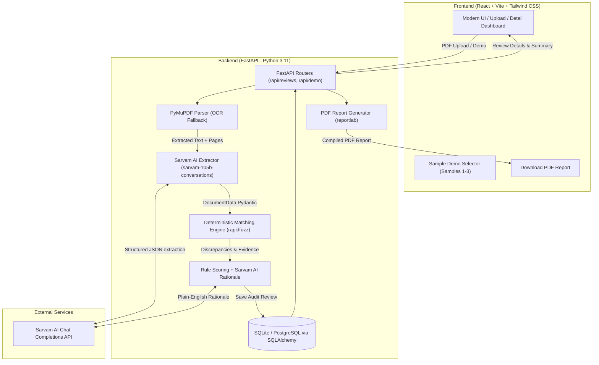

# AP Agent (Accounts Payable Autonomous Audit & Discrepancy Detection Agent)

**AP Agent** is an autonomous Accounts Payable MVP that ingests vendor Invoice PDFs and Purchase Order (PO) PDFs, extracts structured financial and line-item data via **Sarvam AI**, executes a **deterministic 2-way matching engine** in Python, detects discrepancies with source citations, computes a compliance score, and generates audit reports.

---

## Architecture Diagram



---

## Core Features

1. **Dual Document Processing**:
   - Accepts vendor invoice PDF and Purchase Order PDF (drag-and-drop, ≤10MB).
   - High-performance text extraction using **PyMuPDF** (`fitz`).
   - Graceful fallback to OCR (`pytesseract` + `pdf2image`) for scanned receipts/documents.
2. **AI-Powered Structured Data Extraction**:
   - Instructs **Sarvam AI** (`sarvam-105b-conversations`) to extract vendor, document numbers, dates, GSTIN, line items, currency, subtotal, and tax breakdowns.
   - Pydantic schema validation (`DocumentData`) with automatic retry on malformed JSON.
3. **Deterministic Matching Engine**:
   - **Never leaves compliance decisions to LLM hallucinations**.
   - Line items matched via token sort fuzzy matching (`rapidfuzz`) coupled with price and quantity proximity bonuses.
   - Detection flags:
     - `LINE_ITEM_PRICE_MISMATCH` (Billed price > PO price)
     - `LINE_ITEM_QTY_MISMATCH` (Quantity over-billing or under-delivery)
     - `LINE_ITEM_TAX_MISMATCH` (e.g. 28% GST charged instead of 18%)
     - `LINE_ITEM_EXTRA_ON_INVOICE` (Unapproved items not on PO)
     - `LINE_ITEM_MISSING_FROM_INVOICE` (Items ordered but not invoiced)
     - `TOTAL_MISMATCH` & `SUBTOTAL_MISMATCH` (Rounding tolerance aware)
     - `VENDOR_MISMATCH` & `GSTIN_MISMATCH`
     - `DUPLICATE_INVOICE` (Checks database history to prevent duplicate disbursements)
4. **Rule Decision Scoring & Explainable AI**:
   - Computes an objective compliance score (0–100) and recommendation: **`APPROVE`**, **`REVIEW`**, or **`REJECT`**.
   - Sarvam AI authors a concise 2–3 sentence plain-English rationale explaining the exact financial discrepancies.
5. **Downloadable PDF Audit Report**:
   - Professional PDF generated using `reportlab` with severity badges, expected vs. actual values, verbatim text quotes, page numbers, and human reviewer notes.
6. **Pre-built Demo Samples (Indian GST Invoices)**:
   - **Sample 1**: Clean match → `APPROVE` (Score 100/100)
   - **Sample 2**: Unit price & quantity mismatch + wrong GST rate → `REJECT` (Score 0/100)
   - **Sample 3**: Unapproved extra line item + total mismatch → `REVIEW` / `REJECT`

---

## Environment Variables

### Backend (`backend/.env`)

| Variable | Description | Default |
| :--- | :--- | :--- |
| `SARVAM_API_KEY` | Sarvam AI API Key (required) | `""` |
| `SARVAM_BASE_URL` | Sarvam AI Base URL | `https://api.sarvam.ai/v1` |
| `SARVAM_MODEL` | Sarvam AI Model Name | `sarvam-105b-conversations` |
| `ALLOWED_ORIGINS` | Comma-separated CORS origins | `http://localhost:5173,http://localhost:3000` |
| `DATABASE_URL` | SQLAlchemy Database Connection URL | `sqlite:///./data/ap_agent.db` |
| `TOLERANCE_ABSOLUTE` | Absolute rounding tolerance (₹) | `1.0` |
| `TOLERANCE_PERCENT` | Percentage rounding tolerance | `0.005` (0.5%) |

### Frontend (`frontend/.env`)

| Variable | Description | Default |
| :--- | :--- | :--- |
| `VITE_API_URL` | Target FastAPI backend URL | `http://localhost:8000` |

---

## Local Setup & Development

### Prerequisites
- Python 3.11+
- Node.js 18+ and npm
- (Optional) Tesseract OCR & Poppler if processing scanned PDFs locally

### 1. Backend Setup

```bash
cd backend

# Create and activate virtual environment
python -m venv .venv
source .venv/bin/activate  # On Windows: .\.venv\Scripts\Activate.ps1

# Install dependencies
pip install -r requirements.txt

# Configure environment
cp .env.example .env
# Enter your SARVAM_API_KEY in backend/.env

# Run automated tests
python -m pytest -v tests/

# Start FastAPI server
uvicorn app.main:app --reload --port 8000
```
Backend API will be running at `http://localhost:8000` (docs at `/docs`, health check at `/health`).

### 2. Frontend Setup

```bash
cd frontend

# Install npm dependencies
npm install

# Start Vite dev server
npm run dev
```
Frontend will be accessible at `http://localhost:5173`.

### 3. Generate Sample PDFs

```bash
python scripts/generate_samples.py
```
This produces 3 Indian GST sample invoice and purchase order pairs in `/samples`.

---

## Deployment Guide

### Deploying Backend to Render (Docker Web Service)

1. Connect your GitHub repository to [Render](https://render.com).
2. Create a **New Web Service** pointing to the repository.
3. Configure settings:
   - **Root Directory**: `backend`
   - **Environment**: `Docker`
   - **Dockerfile Path**: `Dockerfile`
   - **Health Check Path**: `/health`
4. Set Environment Variables in Render Dashboard:
   - `SARVAM_API_KEY`: `<Your Sarvam AI Key>`
   - `ALLOWED_ORIGINS`: `https://<your-vercel-app>.vercel.app,http://localhost:5173`
   - `DATABASE_URL`: `sqlite:///./data/ap_agent.db`
5. Click **Create Web Service**.

> **Note on Render Free Tier**:
> - **Spin-Down on Inactivity**: Free instances sleep after 15 minutes of inactivity. The first request may take 30–50 seconds to respond. The frontend includes an automatic "Waking up server..." status banner.
> - **Ephemeral Storage**: Render free tier disks are ephemeral. SQLite records reset on redeployment. For production persistence, configure a Render Persistent Disk (Disk Mount: `/app/data`) or point `DATABASE_URL` to a PostgreSQL instance (e.g., Render Managed Postgres / Supabase).

### Deploying Frontend to Vercel

1. Import your GitHub repository into [Vercel](https://vercel.com).
2. Configure settings:
   - **Root Directory**: `frontend`
   - **Framework Preset**: `Vite`
   - **Build Command**: `npm run build`
   - **Output Directory**: `dist`
3. Add Environment Variable:
   - `VITE_API_URL`: `https://<your-render-service>.onrender.com`
4. Click **Deploy**.

---

## Known Limitations & Production Roadmap

- **Free-Tier Cold Starts**: Render's free tier spins down backend services after inactivity. First request latency can be 30-50s.
- **OCR Engine Dependency**: Full scanned-image OCR requires system binaries (`tesseract` and `poppler`), which are pre-packaged in the backend Docker image but require manual installation when running locally on bare Windows without Docker.
- **Multi-Page Table Pagination**: High-volume invoices spanning >10 pages with complex split tables may require chunked pagination in future revisions.
- **ERP Integration**: Designed as an autonomous verification MVP; direct webhook integrations with SAP, Oracle NetSuite, and Tally are out-of-scope for the MVP.
